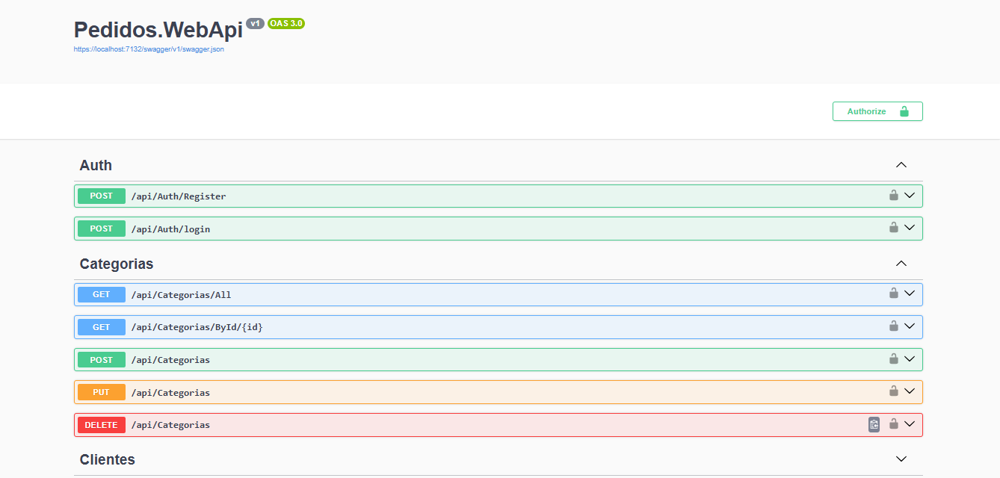
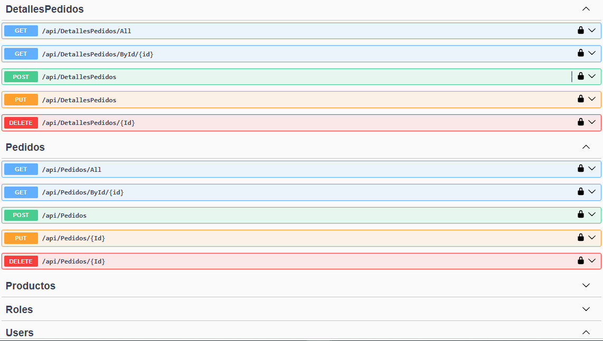
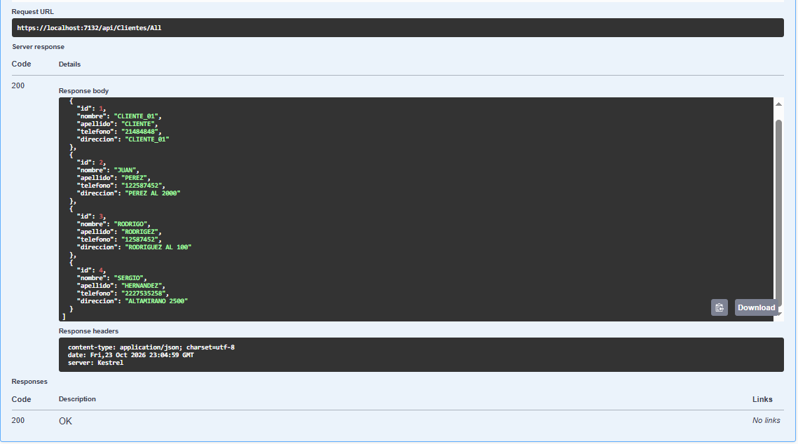
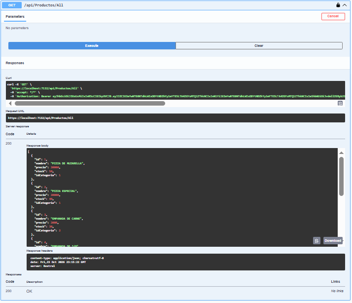
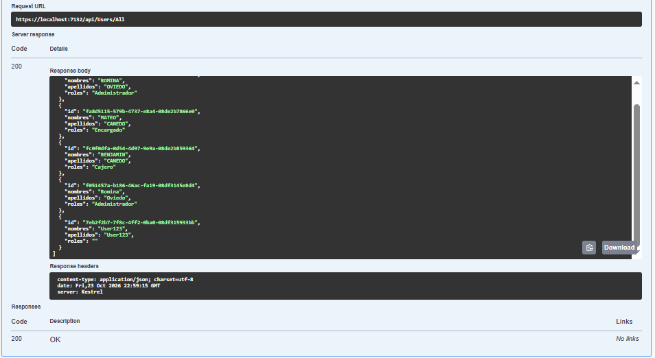

# Pedidos Web API

Proyecto académico de desarrollo backend realizado en el marco de mi formación como Técnica Superior en Análisis,
Desarrollo y Programación de Aplicaciones, enfocado en el diseño y desarrollo de una API REST con ASP.NET Web API.

El desarrollo me permitió aplicar conceptos de arquitectura, separación de responsabilidades,
autenticación y acceso a datos, incorporando herramientas y tecnologías utilizadas en el desarrollo backend.

---

## ¿De qué trata el proyecto?

La aplicación expone una API REST para la gestión de pedidos y usuarios, permitiendo la autenticación
mediante JWT y el acceso seguro a los distintos endpoints.

El backend está desacoplado del frontend, por lo que la API puede ser consumida por aplicaciones web,
móviles u otros servicios.

## 

## Tecnologías utilizadas

- ASP.NET Web API
- .NET / C#
- Entity Framework Core
- SQL Server
- ASP.NET Identity
- JWT (JSON Web Tokens)
- AutoMapper
- Swagger (OpenAPI)

---

## Arquitectura y organización

El proyecto está organizado en capas básicas, buscando mantener una estructura clara y comprensible:

- **Entidades**: modelos del dominio
- **Abstracción**: interfaces y contratos
- **Repositorio / Datos**: acceso a datos y Entity Framework Core
- **Aplicación**: DTOs y modelos de transferencia de datos
- **AplicacionWebApi**: controladores, configuración, autenticación y documentación de la API

En la etapa actual del proyecto, la lógica de negocio se encuentra implementada directamente
en los controladores, priorizando la claridad y el aprendizaje del flujo completo de una Web API.  
La arquitectura queda preparada para una futura refactorización hacia una capa de servicios
si el proyecto lo requiere.

---

## Decisiones de diseño actuales

En la versión actual del proyecto, algunos cálculos de negocio se reciben desde los DTOs
con el objetivo de simplificar el flujo y priorizar la comprensión del funcionamiento general de la API.

Por ejemplo, el **Total del pedido** se recibe actualmente desde el DTO.
En una versión futura, este valor podría calcularse directamente a partir de los subtotales
de cada `DetallePedido`, fortaleciendo la consistencia del dominio y la lógica de negocio.

---

## Seguridad

La API implementa autenticación basada en JWT y gestión de usuarios y roles mediante ASP.NET Identity.  
Los endpoints protegidos requieren un token válido para su acceso.

---

## Uso y documentación

La API cuenta con documentación interactiva generada automáticamente con Swagger,
lo que permite visualizar y probar los endpoints de forma intuitiva,
sin necesidad de revisar el código.

---

## Aprendizajes y objetivos

Este proyecto me permitió:

- Comprender el diseño de APIs REST
- Implementar autenticación y autorización
- Trabajar con Entity Framework Core y SQL Server
- Aplicar inyección de dependencias
- Organizar un proyecto backend de forma clara y mantenible
- Comprender el flujo completo de una petición desde el controller hasta la base de datos

Forma parte de mi proceso de crecimiento como desarrolladora, integrando tanto aspectos
técnicos como buenas prácticas de organización y presentación del código.

---

## Galeria de Imágenes

## 

## 

## 

## 
